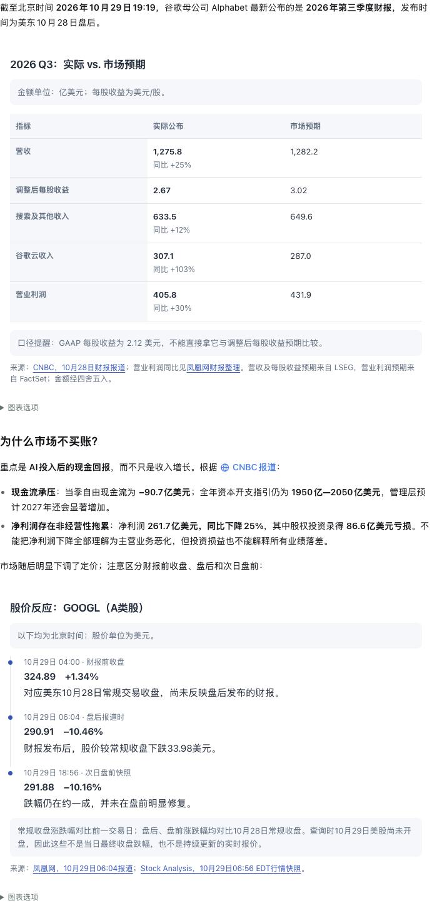
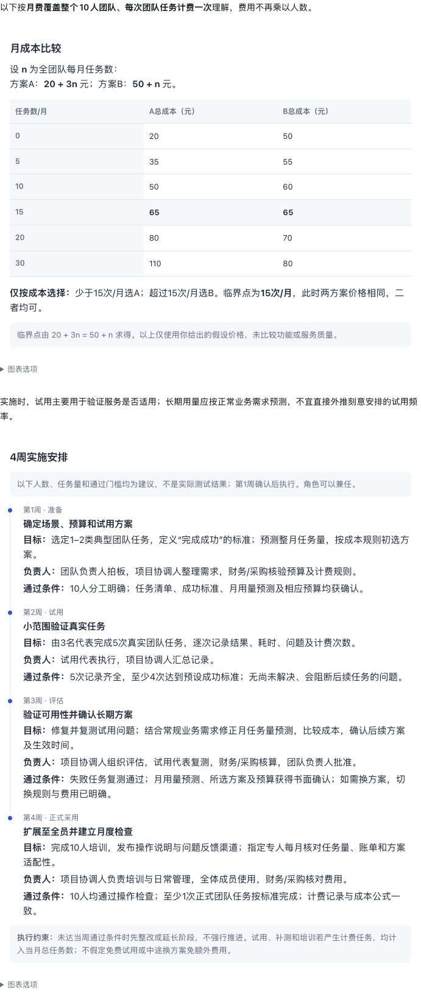
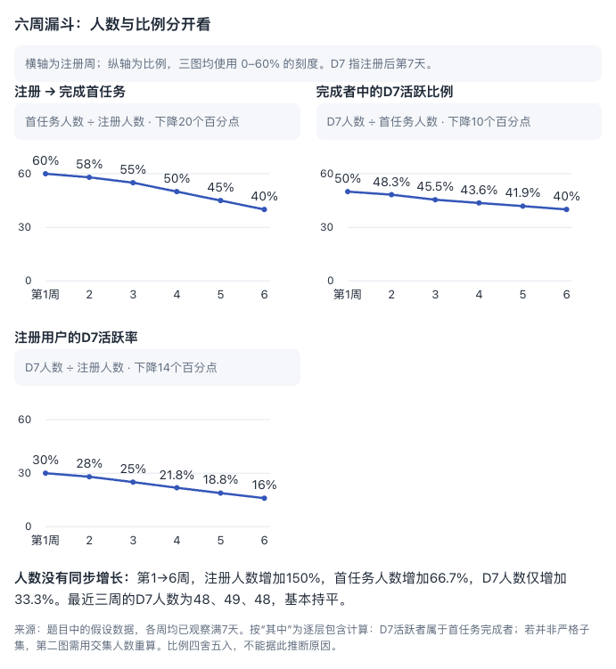
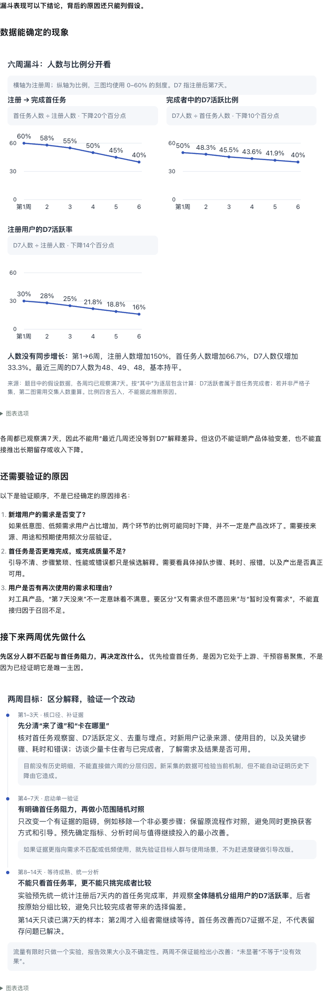
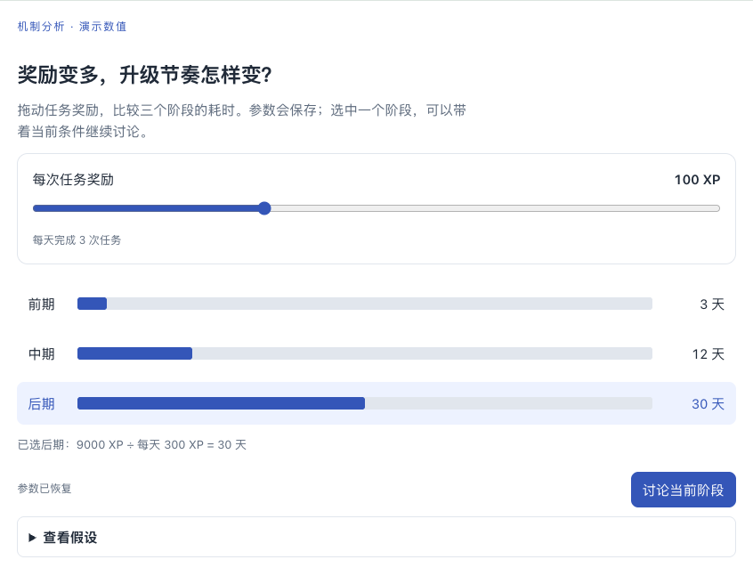
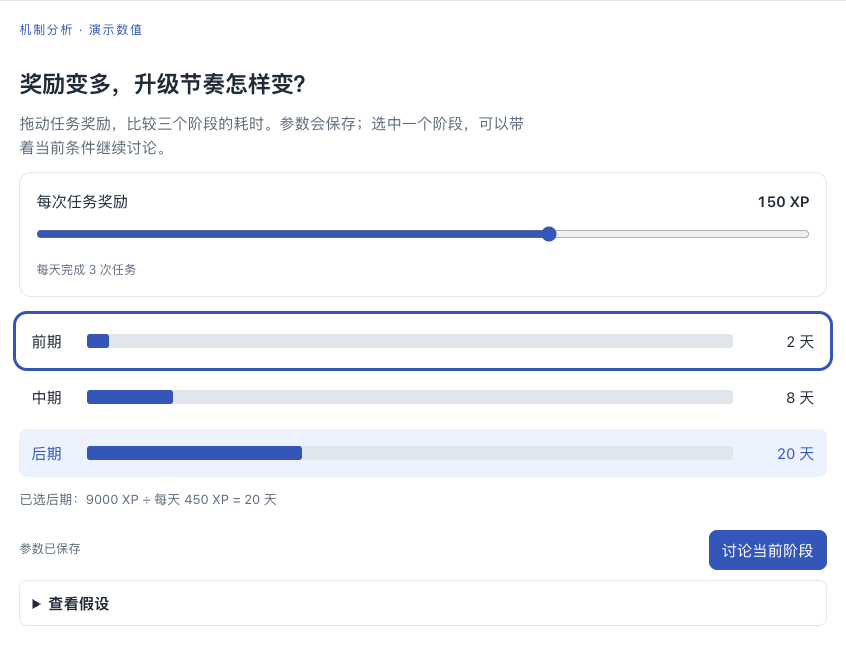

# DSH Better Answer View

**简体中文** | [English](README.en.md)

让 AI 回答更易读、更好交互。

DSH Better Answer View 是面向 DeepSeek Harness 的内嵌可视化与交互插件，让 AI 自动把适合的内容显示成回答里的图表、卡片和交互块。图文块可以插在文字段落之间；参数保存到本机，模型更新内容时保留兼容的状态，并能回看历史版本。

这是可运行原型，适配 **DeepSeek Harness 网页版 0.1.5-rc.3** 和 **桌面版 0.2.1-rc.3**。不是 ChatGPT 内部实现，也不要求发明新的标记语言。

## 看看回答会变成什么样

正常提问即可，无需加上“用网页展示”或“生成卡片”。适合比较、趋势或步骤的内容可以在回答中分块呈现；文字负责解释和连接，简单问题仍直接回答。

下面前三组是 **DSH 桌面版中真实模型回答的截图**，使用插件 0.3.1；截图只保留回答区域。首组来自实际财报查询，后两组使用虚构数据。第四组是仓库自带的交互演示，单独标明来源。GitHub 中的图片是静态预览，运行下方演示即可实际操作。

### 1. 谷歌财报与股价反应：一个日常问题，自动组织成图文回答

实际提问：

> 谷歌最新财报和股价反应

没有指定展示格式。回答先用表格比较业绩与市场预期，在正文中解释市场关注点，再用独立时间线区分财报前收盘、盘后和次日盘前。来源链接和口径说明保留在相关内容旁边。



这是 2026-10-29 保存的原始模型回答，用于展示排版与嵌入效果；其中财务数字和行情未在本仓库独立核验，截图不是实时行情。

### 2. 比较成本，再安排实施：同一回答里的两个独立块

> 两个收费方案，哪个更划算？接下来四周如何落地？

<details>
<summary>展开完整提问（可直接复制）</summary>

我们准备为一个10人团队启用一项服务。假设方案A每月固定20元，每次团队任务另付3元；方案B每月固定50元，每次团队任务另付1元。请比较每月进行0、5、10、15、20、30次任务时的总成本，说明选择哪个方案以及临界点。也请给出从准备、试用、评估到正式采用的4周实施安排，明确每周目标、负责人角色和通过条件。这些价格是我给出的假设，实施安排请基于这些条件给建议，不需要查外部资料。

</details>

实际回答按 **引入文字 → 成本比较 → 衔接文字 → 四周实施安排** 排列。两个可视化块分别嵌入正文，内容自然展开；不需要另开网页，也没有在正文中再抄一遍表格。



### 3. 判断产品问题：趋势图、原因边界和验证计划

> 注册人数持续上涨，为什么完成任务和留存没有跟上？未来两周先验证什么？

<details>
<summary>展开完整提问（可直接复制）</summary>

帮我判断一个工具产品最近六周主要出了什么问题，接下来两周应该优先验证什么。第1至6周的新注册人数分别是120、150、180、220、260、300；其中完成首个任务的人数是72、87、99、110、117、120；其中第7天仍活跃的人数是36、42、45、48、49、48。各周都是同一批注册用户，都已观察满7天，所有数字只是用于讨论的假设，没有其他数据。请区分数据能确定的现象和还需要验证的原因。

</details>

相关趋势放在同一个块中，用统一比例尺比较；正文区分已知现象与待验证原因，随后用另一个块呈现两周计划。按主题拆分，不是每个数字都做一张卡片。



<details>
<summary>查看完整回答：趋势图 → 原因分析 → 两周验证安排</summary>



</details>

### 4. 调整参数，立即看到结果

可以尝试这样的问题：

> 设计一个升级进度计算器：每天完成3个任务，三个阶段分别需要900、3600、9000 XP。让我调整每次任务的奖励，比较各阶段需要多少天，并能围绕选中的阶段继续讨论。

下面用仓库自带的 [升级进度演示](examples/leveling.html) 展示这种交互能力。**这是预先编写的本地演示，不是上述提问生成的模型回答。**

| 每次任务 100 XP | 调整到 150 XP |
| --- | --- |
|  |  |

拖动滑块即可本地重算，无需每次请求模型。此演示已实际验证：

- 后期所需天数从 **30 天变成 20 天**，刷新后仍保留 150 XP。
- 点击“将后期需求降低 30%”后，奖励参数继续保留，结果变为 **14 天**。
- 选择阶段后可准备追问，确认发送后才提交。

### 5. 简单问题，保持简单

实际提问：**17乘以6是多少？**

实际回答：**17 × 6 = 102。**

这次没有生成可视化块。插件希望在展示有助于理解时增强回答，而不是把所有回答都装进卡片。

模型生成的布局会随模型与问题而变化，上面展示的是已验证的具体回答。更多截图来源与复现说明见 [展示说明](examples/showcase/README.md)，已完成的检查及限制见 [验证记录](VALIDATION.md)。

## 先运行演示

需要 Node.js 22 或以上版本。克隆仓库后运行：

```sh
git clone https://github.com/solstice621/dsh-better-answer-view.git
cd dsh-better-answer-view
npm ci --legacy-peer-deps
npm run build
npm run demo
```

打开 <http://127.0.0.1:3091>。修改奖励、选择阶段、刷新浏览器，再点击“将后期需求降低 30%”，验证状态保留和历史版本。页面内“讨论当前阶段”会在页面外准备追问，点击“发送追问”才提交。

演示使用虚构数据，不调用模型。演示中的“发送”只展示捕获到的文本；安装到 DSH 后，同一组件会将追问发送到当前会话。

可用环境变量：`PORT` 指定端口，`WEB_ANSWER_DATA_DIR` 指定演示数据目录。默认数据写入项目的 `work/demo-data/`。

## 接入 DSH

项目名称与插件安装标识均为 `dsh-better-answer-view`。0.3.3 将旧包 `dsh-web-answer` / `better-view-for-dsh` 统一更名；升级时先停用并移除旧包，再安装新包，避免同时注册同名工具。页面存储目录和回执格式保持兼容，历史回答及已保存状态仍可读取。

推荐从 [GitHub Release](https://github.com/solstice621/dsh-better-answer-view/releases/latest) 下载预构建的 `dsh-better-answer-view-0.3.3.tgz`，在桌面插件管理器中安装；无需本地构建。CLI/Web 可直接运行：

```sh
dsh plugin --profile web add "https://github.com/solstice621/dsh-better-answer-view/releases/download/v0.3.3/dsh-better-answer-view-0.3.3.tgz"
```

Git 仓库也包含预构建的客户端入口，可从 Git 安装：

```sh
dsh plugin --profile web add "github:solstice621/dsh-better-answer-view#v0.3.3"
```

桌面应用和单独安装的 CLI/Web 使用不同的 profile，插件不会自动同步。桌面版应通过其插件管理器安装 `dsh-better-answer-view-0.3.3.tgz` 并启用；它使用 desktop profile。下列 CLI 命令仅安装到该 CLI 的 web profile。

Git 仓库提供源码。完成依赖安装后，在项目目录构建并生成桌面安装包：

```sh
npm run build
npm pack
```

生成的 `dsh-better-answer-view-0.3.3.tgz` 可交给桌面版插件管理器安装。

构建完成后，向需要使用的 DSH Web profile 安装本地插件：

```sh
dsh plugin --profile web add "link:$PWD" --ignore-scripts --offline
dsh --profile web
```

以上命令应在本项目目录执行；`web` 换成实际 profile 名称。如果 DSH 已启动，需要重启并刷新网页。安装是本地链接，移动项目目录会使链接失效。

如果希望先在独立环境试用，可以给 DSH 指定新的 `DSH_HOME`。注意某些安装器提供的 `dsh` 包装脚本会覆盖该变量；这种情况下应直接调用安装目录中的 Node 与 DSH 入口。本机验证使用如下形式：

```sh
# 替换成你的 DSH 安装目录；以下命令在插件目录运行。
WA_DSH_INSTALL=/absolute/path/to/deepseek-harness
export DSH_HOME="$PWD/work/dsh-profile"
export DSH_TELEMETRY_DISABLED=1
"$WA_DSH_INSTALL/runtime/bin/node" \
  "$WA_DSH_INSTALL/lib/node_modules/@deepseek-ai/dsh/lib/bin.js" \
  plugin --profile web add "link:$PWD" --ignore-scripts --offline
"$WA_DSH_INSTALL/runtime/bin/node" \
  "$WA_DSH_INSTALL/lib/node_modules/@deepseek-ai/dsh/lib/bin.js" \
  --profile web --no-open --host 127.0.0.1 --port 3092
```

独立环境需要自行配置模型才能生成真实回答。前面的演示不需要模型配置。

插件的 bundle patch 加载宿主入口；客户端通过 DSH 的模块加载器注册自定义聊天节点和工具回执。插件兼容两个版本不同的工具结果格式；其他 DSH 版本仍需要重新验证。0.1.3 修复了桌面版中网页保存成功但对话中不显示的问题，已有页面会在重新打开会话后恢复。

插件默认将页面数据保存到 `$DSH_HOME/web-answer/`；未设置 `DSH_HOME` 时使用 `~/.dsh/web-answer/`。也可以在插件配置中指定绝对路径 `storageDir`。

安装后正常提问即可，例如：

> 比较两个收费方案在不同使用次数下的成本，说明临界点。

当趋势、比较、步骤或交互的视觉结构有助于理解时，插件会指导模型主动使用紧凑内容块，无需点名网页或工具。简单事实、普通说明、确认和代码问答保留普通文字，并尊重用户明确指定的格式。视觉内容只出现一次；周围文字用于引入、连接或补充，不再用 Markdown 重复整份回答。这是模型指导，不是对任意回答的语义去重过滤器。

0.2.0 支持在同一条回答中按“文字 → 图文块 → 后续文字”的顺序展示，不打开新网页。常驻标题和版本工具栏已收进“图表选项”。旧回答没有位置标记时，仍在本轮末尾显示保存的内容；不会改写历史消息。

0.2.1 明确默认按主题拆分：有两个及以上适合可视化的独立主题时，分别调用工具生成小块（通常 2–4 个），按“文字 → 小块 → 有用的衔接 → 小块”的顺序放在正文里。将多个卡片堆进一个 HTML 不算独立嵌入。图表与图例等紧密相关内容仍可合并，只有一个视觉主题时只用一个块；不会为了数量拆碎内容。此规则通过模型指令实现，实际执行需以真实模型测试为准。

0.3.0 增加统一的紧凑样式：比较图、关键数字、时间线、决策依据和交互控件可复用同一套明暗主题、字体与间距。模型应在视觉结构有实际作用时使用卡片，普通说明、翻译、简单事实或几句建议无需卡片。嵌入块按内容自然展开，移除原先的高度上限及“展开高度”按钮；常见整页高度、窄屏宽表格和说明用滚动面板会调整为适合正文的布局。编辑框等确实需要内部滚动的控件仍保留自身交互。

0.3.1 补充按真实聊天可用宽度的回归：窄屏图表保持统一比例尺，外侧放不下的数值可完整移入柱内；指标数字保持完整，宽度恢复后排版随之恢复。

## 模型工具

| 工具 | 用途 | 关键参数 |
| --- | --- | --- |
| `render_answer` | 新建网页回答 | `title`、`html`、`summary`；可选 `initialState`、`stateSchemaVersion` |
| `get_answer` | 读取 HTML、当前状态和版本 | `id`；可选 `revision` |
| `update_answer` | 更新同一个回答 | `id`、`expectedRevision`、完整 `html`；可选标题、说明和状态契约 |

工具自动绑定执行所在会话，模型不能指定另一会话。`render_answer` / `update_answer` 返回小型回执供聊天节点渲染；HTML 保存在本机，不重复塞进回执。更新前应先 `get_answer`，再使用返回的最新版本号，避免覆盖其他更新。

回执的 `embed` 字段提供位置标记。模型把它原样放在最终回答的段落之间（独占行、不加代码围栏），客户端会在该处显示图文块。标记形如 `:::web-answer <页面 UUID>` 换行后 `:::`。只解析同轮成功工具回执，不执行用户文本、代码示例或推理中的标记。引用成功后不再追加一份相同内容；中途被折叠的步骤不会吞掉本轮末尾的回退展示。普通文字、推理与图片继续委托给宿主原生组件。

页面更新采用完整替换。相同 `stateSchemaVersion` 保留当前状态；变更该版本时必须提供新的 `initialState`。历史页面可以查看和本地交互，但不能保存状态。

## 页面编写约定

优先提交表达一个视觉主题的 HTML 片段，完整 HTML 文档也支持。可复用 `.answer-metric-grid`、`.answer-bar-list`、`.answer-timeline`、`.answer-decision`、`.answer-control` 等内置样式；自定义图形使用 `--answer-fg`、`--answer-muted`、`--answer-accent` 等主题变量。按需补充内联 CSS 和经典 JavaScript，可以使用原生 SVG、Canvas、CSS 布局，不支持 CDN、外链脚本和 `type="module"`。新增视觉样式使用 `answer-` 前缀，避免误改旧回答中常见的自定义类名。

卡片使用自然高度，内容适应窄屏，不使用 `100vh` 页面壳、固定高度滚动面板或宽表格的 `min-width`。长解释放在正文或另一个有明确用途的块里；表格只保留有用的列，必要时改成逐项排列。真实输入控件可以保留内部滚动；特殊交互面板可用 `data-answer-scroll` 明确声明，但不能用它把普通内容做成长页面。

脚本执行时页面 DOM 已插入，应直接初始化；不要等待 `DOMContentLoaded` 或 `window.load`，因为承载文档的这些事件已经发生。

```html
<label>奖励 <input id="reward" type="range" min="50" max="200"></label>
<output id="value"></output>
<button id="discuss">讨论当前设置</button>
<script>
  const input = document.querySelector('#reward');
  const value = document.querySelector('#value');
  const state = window.answer.getState();
  input.value = state.reward ?? 100;
  function draw() { value.textContent = input.value + ' XP'; }
  input.addEventListener('input', draw);
  input.addEventListener('change', async () => {
    try { await window.answer.setState({ reward: Number(input.value) }); }
    catch (error) { value.textContent = '保存失败：' + error.message; }
  });
  document.querySelector('#discuss').addEventListener('click', async () => {
    await window.answer.setState({ reward: Number(input.value) });
    await window.answer.ask('请分析当前奖励设置。');
  });
  draw();
</script>
```

Bridge API：

- `getState()` 返回当前 JSON 状态的副本。
- `await setState(object)` 保存明确的参数和选择，失败时 Promise 拒绝。
- `await ask(text)` 准备追问，附带页面 ID、revision 和当前状态。用户仍需在宿主界面点击发送。

拖动过程应只做本地计算，结束拖动时保存。避免每次操作都请求模型。状态必须是 JSON 对象；不会自动恢复任意 DOM、滚动位置或第三方组件的内部状态。

运行时提供浅色/深色主题及 `--answer-bg`、`--answer-fg`、`--answer-muted`、`--answer-border`、`--answer-soft`、`--answer-accent`、`--answer-accent-soft` 等 CSS 变量，还有 `.card`、`.grid`、`.row`、`.badge`、`.primary` 基础样式。完整示例见 `examples/leveling.html`。

## 当前边界

- 页面完整生成后执行，不提供逐 token 的 HTML 预览；更新整个页面时会重新执行脚本。
- iframe 仅开放脚本权限，不开放同源权限；通过私有 MessageChannel 保存状态和准备追问。页面不能读取宿主 DOM、浏览器存储或直接调用宿主工具。
- CSP 限制外部资源和请求，sandbox 限制顶层跳转与弹窗。不过浏览器无法靠这套通用配置完全阻止 iframe 自身导航；运行时检测到导航会停用通道并清空页面。此原型不应被当成任意敌意代码的安全执行环境。
- HTML 上限 256 KiB，JSON 状态上限 16 KiB，追问文本上限 8 KiB。模型需要提供 `summary`，页面运行失败时可阅读文字说明并回看上一版。
- 采用本机文件存储、原子提交和版本冲突检测。支持同进程内并发操作；同一数据目录应由一个写入进程使用。继承到其他会话的页面只供查看，不能写回原会话；暂未实现云同步、跨会话复制或 fork 后的独立页面副本。
- 深色模式跟随系统偏好。远程图片、网络数据、外部页面跳转和文件下载不属于此版交互范围。

## 开发与验证

```sh
npm run build
npm test
npm run test:browser
```

浏览器测试会在独立临时数据目录启动演示服务，验证计算、保存、重启恢复、版本历史、状态冲突、追问、主题、手机布局和脚本错误回退。默认端口 3101，可用 `TEST_PORT` 覆盖。macOS 优先使用已安装的 Google Chrome；其他环境可设置 `CHROME_PATH`，或运行 `npx playwright install chromium`。

可选：让会话节点测试直接使用安装版 DSH 的 assembler，而非仅验证模拟调用：

```sh
DSH_CONVERSATION_CLIENT_BUNDLE=/absolute/path/to/@deepseek-ai/dsh-client-ui-conversation/lib/client.js \
DSH_CHAT_CLIENT_BUNDLE=/absolute/path/to/desktop/@deepseek-ai/dsh-client-ui-chat/lib/client.js npm test
```

代码分工：`host.js` 注册工具和认证后的 HTTP API，`conversation.js` 把工具事件组装为聊天节点，`client.jsx` 接入 DSH 插槽，`view-ui.jsx` 管理页面 UI，`surface-runtime.js` 执行 iframe 与 bridge，`view-store.js` 管理持久化与历史。
